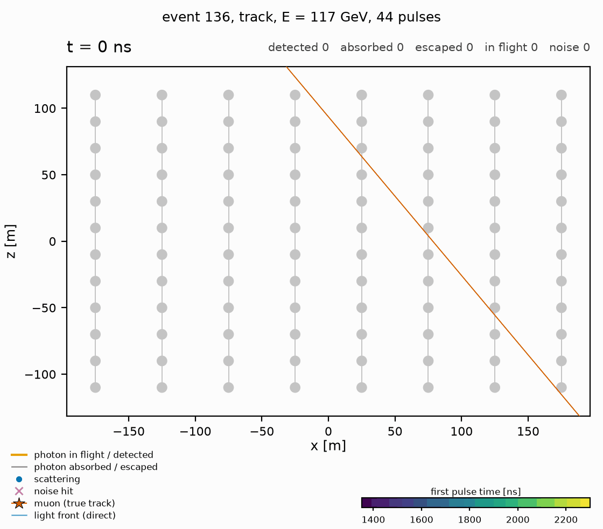

# fm-nu-telescope

[](https://github.com/ArseniiGav/fm-nu-telescope/actions/workflows/ci.yml)
[](https://www.python.org/downloads/)
[](LICENSE)
[](https://github.com/astral-sh/ruff)

**Foundation models for neutrino telescopes**, built up from first principles. A neutrino telescope records the
Cherenkov light of muons and particle showers with thousands of optical modules on vertical strings in deep water or
ice; reconstructing an event means inferring its direction, energy and type from the times and charges of the pulses.
This project starts with **Light in the Deep**, a two-dimensional neutrino telescope simulated photon by photon, on
which students learn the detector, the physics of the light and the basic reconstruction. It then trains neural
networks on the toy, moves to a model trained on many detectors at once (a foundation model, with pretraining,
transfer to unseen detectors and scaling laws), and finally to the open benchmark NuBench and to TRIDENT. The
repository `fm-nu-telescope` holds the Python package `nutel` (the toy is `nutel.toy`, its command line `nutelsim`),
its documentation and the tasks for the students.

<p align="center">
  
  <br>
  <em>A muon (star) crosses the strings and its Cherenkov photons fly out at c/n: each line is the path of one photon,
  the blue dots are its scatterings, absorbed photons turn grey, and a hit module grows with its charge and takes the
  colour of its first pulse time; the crosses are noise hits over the whole 5 µs readout window.</em>
</p>

## Roadmap

| stage | content                                                                                                   | status               |
|-------|-----------------------------------------------------------------------------------------------------------|----------------------|
| A     | **Light in the Deep**: the toy telescope, its data, the multi-detector option and the physics tasks T0-T5 ([TASKS.md](TASKS.md)) | this release (0.1.0) |
| B     | Basic machine learning on the toy: features, sets, graphs and attention for direction, energy and type    | next                 |
| C     | A foundation model on the toy: many detectors in the training set, pretraining, transfer, scaling         | later                |
| D     | NuBench, the open benchmark for event reconstruction in neutrino telescopes ([arXiv:2511.13111](https://arxiv.org/abs/2511.13111)) | later |
| E     | TRIDENT                                                                                                   | later                |

## The toy telescope

<p align="center">
  
</p>

A vertical slice of water (or ice) holds 8 strings of 12 optical modules, 50 m apart horizontally and 20 m vertically.
Four kinds of events cross it: through-going muons, starting tracks (a $\nu_\mu$ interaction inside the detector: a
shower plus a muon), showers (cascades) and down-going atmospheric muons. A muon emits Cherenkov light at
$\cos\theta_c = 1/n$ to its direction, two rays in the plane, plus bursts of light from stochastic energy losses, and
may stop when it runs out of energy; a cascade emits around the Cherenkov angle with a wide spread. Every photon is
tracked until it is absorbed, escapes or hits a module; scattering is forward-peaked. The modules record hits with a
time jitter, efficiency and noise, merged into pulses. Absorption, scattering, stochastic losses and the readout effects
are switched on step by step along a ladder of presets (`straight`, `absorb`, `scatter`, `full`). The model, with all
equations and derivations, is in [docs/physics.md](docs/physics.md).

| parameter                              | default (`full`, water)                                   |
|----------------------------------------|-----------------------------------------------------------|
| detector                               | 8 strings x 12 modules, $d_s$ = 50 m, $d_m$ = 20 m, module radius 0.5 m |
| medium: water / ice                    | $n$ = 1.35 / 1.32, $\lambda_a$ = 60 / 100 m, $\lambda_\mathrm{eff}$ = 300 / 25 m, $g$ = 0.8 |
| track light                            | 1.75 photons per metre (about 30 detected photons in a median event), Cherenkov angle spread 1° |
| cascade light                          | as 5 m of track per GeV, angular profile of electromagnetic showers (Rädel and Wiebusch) |
| muon energy loss                       | ionisation 0.25 GeV/m; bursts $dN/(dx\,dv) = b/v$, $b = 3.3 \times 10^{-4}$ /m, $v \ge 10^{-3}$ |
| readout                                | efficiency 1, jitter 1 ns, noise 50 kHz (water) / 0.5 kHz (ice) per module, window 5 µs, pulses merged within 3.5 ns |
| event types                            | track 40 %, starting 20 %, cascade 20 %, atmospheric 20 % |
| energies (log-uniform)                 | tracks $10^2$-$10^4$ GeV, starting tracks ($E_\nu$) $10^2$-$10^3$ GeV, cascades $10$-$10^3$ GeV, atmospheric $10^2$-$10^3$ GeV |
| angles                                 | isotropic; atmospheric muons down-going with the zenith distribution at 2 km water equivalent |

## Installation

Python 3.10 or newer on Linux, macOS or Windows; a laptop is enough (CPU only, no GPU needed).

```bash
git clone https://github.com/ArseniiGav/fm-nu-telescope.git
cd fm-nu-telescope
python3 -m venv .venv
source .venv/bin/activate
python -m pip install -e ".[analysis,dev]"
python -m pytest                                 # fast tests (the "deselected" ones are the slow tests)
python -m ipykernel install --user --name fm-nu-telescope --display-name "Python (fm-nu-telescope)"
```

The last line registers the environment as the Jupyter kernel that the notebooks use. Windows, a smaller CPU-only
PyTorch, GPUs, Intel Macs, `uv`, clusters and common problems: [docs/install.md](docs/install.md).

## Quick start

On the command line (`python -m nutel.toy` works the same way):

```bash
nutelsim presets                                     # the physics ladder, the media and the defaults
nutelsim generate -n 10000 --seed 1                  # -> data/toy_full_water_n10000_seed1.h5
nutelsim generate --preset scatter --medium ice -n 2000 --seed 2 --save-paths 5
nutelsim info data/toy_full_water_n10000_seed1.h5    # detectors, configuration, provenance
nutelsim display data/toy_full_water_n10000_seed1.h5 -i 0 -o event0.png
nutelsim generate --help                             # every option
```

In Python:

```python
from nutel.toy import event_features, generate, load, preset, save

data = generate(10_000, config=preset("full", medium="water"), seed=1)
save(data, "data/toy.h5")
data = load("data/toy.h5")

data.truth.type, data.truth.angle, data.truth.energy  # true event parameters, [10000]
data.pulses.offset, data.pulses.t, data.pulses.charge  # pulses of all events; event i: offset[i]:offset[i + 1]
data.geometry(0).positions  # module positions of the detector of event 0, [96, 2]
features = event_features(data)  # hand-made features, one value per event
```

[examples/quickstart.py](examples/quickstart.py) is a complete short script, and
[notebooks/00_quickstart.ipynb](notebooks/00_quickstart.ipynb) a guided first look at the data.

## The data

One HDF5 file per run holds the true parameters of every event, the photon bookkeeping, the pulses and optionally
every hit (the two levels mirror NuBench's merged photons and pulses), the photon paths, the detectors, the
configuration and the provenance. Types, shapes, units and reading examples are in
[docs/data_format.md](docs/data_format.md).

## Many detectors

`nutelsim generate --family default --n-geometries 16` samples 16 detectors (layout, spacings, module size, medium
between water and ice, noise, efficiency, jitter) and spreads the events over them; every event carries its
`geometry_index` and every pulse its position in metres, so one model can read every layout. `nutelsim family --n 16
-o family.png` draws the sampled detectors, and the `tridentlike` family gives large, sparse, irregular detectors.

## Tasks

[TASKS.md](TASKS.md) holds the tasks of stage A: set-up and the NuBench dictionary (T0), the prior (T1), the light and
the detector response (T2), the physics ladder (T3), event displays (T4) and a bonus on the way to reconstruction,
including a first multi-detector data set (T5). `python examples/make_task_data.py` makes their data on any operating
system.

## Documentation

- [docs/physics.md](docs/physics.md): the model, its parameters and the derivations the tasks use
- [docs/references.md](docs/references.md): the literature behind the defaults
- [docs/data_format.md](docs/data_format.md): the HDF5 files
- [docs/nubench.md](docs/nubench.md): NuBench in one page
- [docs/install.md](docs/install.md): installation details
- [examples/cluster](examples/cluster/README.md): large data sets on a cluster
- [CHANGELOG.md](CHANGELOG.md): changes between versions

## Citation

If you use this material, please cite it as described in [CITATION.cff](CITATION.cff) (GitHub shows it under "Cite
this repository").

## License

[MIT](LICENSE)
