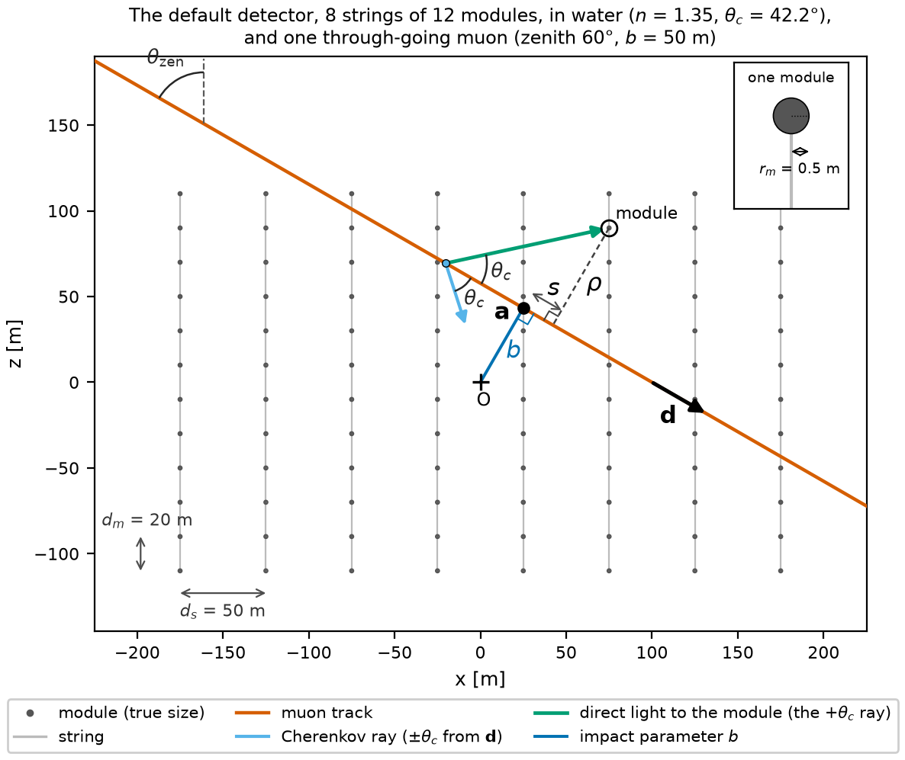
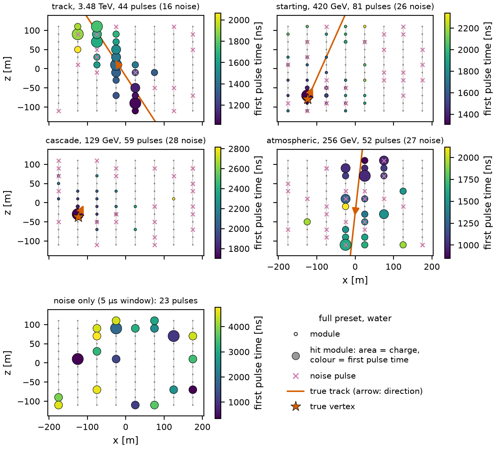
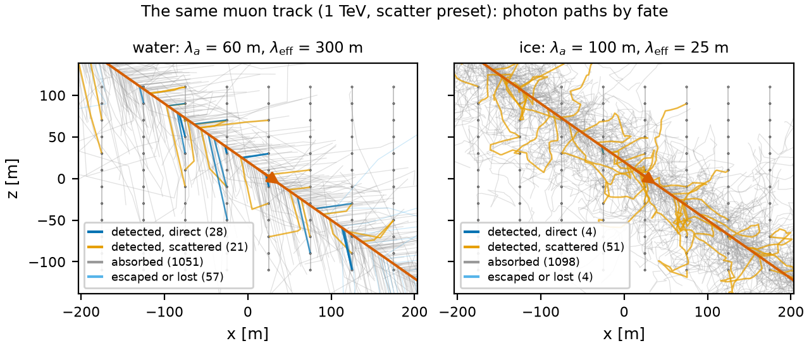
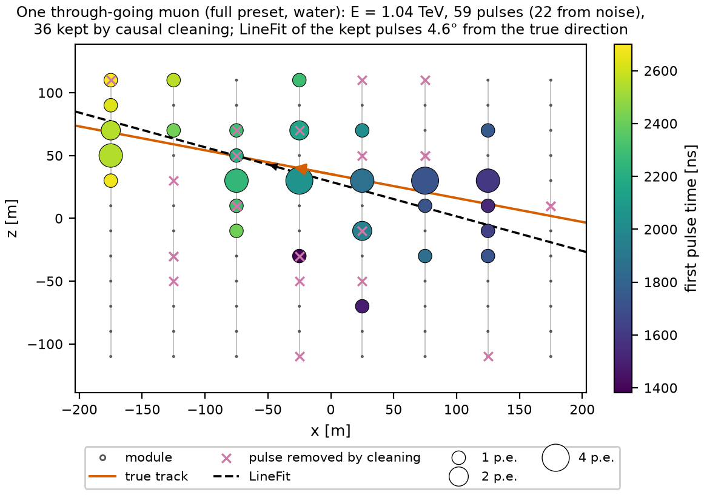
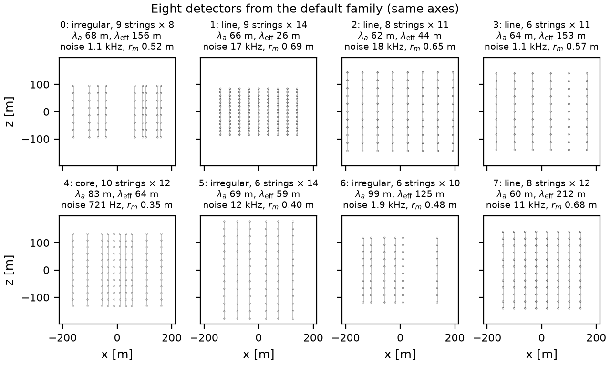

# Physics of the toy telescope

"Light in the Deep" is a two-dimensional neutrino telescope simulated from first principles. A muon track, a cascade
or both cross a vertical slice of water or ice instrumented with strings of optical modules; every Cherenkov photon is
tracked through the medium until it is detected, absorbed or lost, and the modules record hits and pulses. This page
defines the model as implemented in `nutel.toy` (version 0.1.0), with the derivations that the tasks use. The
defaults are those of the `full` preset in water. The data files are described in [data_format.md](data_format.md),
and the literature values behind the defaults, with their sources, in [references.md](references.md).

## Units and coordinates

| quantity                          | unit                 |
|-----------------------------------|----------------------|
| lengths, positions, paths         | m                    |
| times                             | ns                   |
| energies                          | GeV                  |
| speeds                            | m/ns                 |
| noise rate                        | Hz (per module)      |
| angles                            | rad (degrees in the option names that say so) |

The world is a vertical plane: $x$ horizontal, $z$ vertical and pointing up, the origin at the centre of the
instrumented area. Positions and directions have two components, stored in the order $(x, z)$. The speed of light in
vacuum is $c = 0.299792458$ m/ns and in the medium $c_n = c/n_g$, with the group index $n_g$ (equal to the refractive
index $n$ unless set).

## Direction convention

A particle travels along the unit vector $\mathbf{d} = (d_x, d_z)$. As in the telescopes, its direction is given by
where it comes from:

```math
\theta_\mathrm{zen} = \arccos(-d_z) \in [0, \pi], \qquad
\phi_\mathrm{az} = \begin{cases} 0 & d_x < 0 \ \text{(comes from } +x\text{)} \\ \pi & d_x > 0 \ \text{(comes from } -x\text{)} \end{cases},
\qquad \mathbf{d} = \left(-\sin\theta_\mathrm{zen} \cos\phi_\mathrm{az},\; -\cos\theta_\mathrm{zen}\right).
```

$\theta_\mathrm{zen} = 0$ is a particle coming from straight above (down-going), $\theta_\mathrm{zen} = \pi$ one coming
from below (up-going, it crossed the Earth). A vertical slice allows only the two azimuths 0 and $\pi$: the last
formula is the usual three-dimensional $\mathbf{d} = -(\sin\theta \cos\phi, \sin\theta \sin\phi, \cos\theta)$ in the
plane $y = 0$; it is the convention of IceCube
([references.md](references.md#7-direction-convention)). For derivations the plain angle of the direction of travel,
$\alpha = \operatorname{atan2}(d_z, d_x) \in (-\pi, \pi]$, is simpler; the truth stores $\mathbf{d}$,
$\theta_\mathrm{zen}$, $\phi_\mathrm{az}$ and $\alpha$ (`dir_x`, `dir_z`, `zenith`, `azimuth`, `angle`).

## Detector

A detector is a table of optical modules: the `string` and `module` index of each (module 0 is the deepest on its
string) and its centre $(x, z)$. A module is an opaque disc of radius $r_m$ (one value per detector): in two
dimensions its cross-section for light is its diameter $2 r_m$.

| layout      | description                                                                                         |
|-------------|-----------------------------------------------------------------------------------------------------|
| `line`      | default: $N_\mathrm{str}$ strings at a constant horizontal spacing $d_s$, $N_\mathrm{mod}$ modules per string at a vertical spacing $d_m$, centred on the origin |
| `core`      | a dense core: a central group of strings at a smaller spacing, the outer strings sparse             |
| `irregular` | strings at random $x$ with a minimum distance, like a slice through a sunflower or Penrose-like footprint (TRIDENT) |
| `ragged`    | strings with different numbers of modules or vertical offsets                                       |
| `custom`    | any table of modules (`Geometry.from_table`)                                                         |

| parameter                          | symbol             | option                | default | unit |
|------------------------------------|--------------------|-----------------------|---------|------|
| layout                             |                    | `layout`              | `line`  |      |
| number of strings                  | $N_\mathrm{str}$   | `n_strings`           | 8       |      |
| modules per string                 | $N_\mathrm{mod}$   | `modules_per_string`  | 12      |      |
| string spacing                     | $d_s$              | `string_spacing`      | 50      | m    |
| module spacing                     | $d_m$              | `module_spacing`      | 20      | m    |
| module radius                      | $r_m$              | `module_radius`       | 0.5     | m    |
| `core`: central strings            |                    | `n_core`              | 4       |      |
| `core`: their spacing              |                    | `core_spacing`        | 20      | m    |
| `irregular`: smallest string gap   |                    | `min_string_distance` | 20      | m    |
| `ragged`: fewest modules on a string |                  | `ragged_min_modules`  | 6       |      |
| `ragged`: largest vertical offset  |                    | `ragged_max_offset`   | 20      | m    |
| seed of the random layouts         |                    | `layout_seed`         | 0       |      |

The default detector has 96 modules; its **instrumented area**, the bounding box of the module centres, is
$350 \times 220$ m$^2$. A `Geometry` carries the table and a `geometry_id`, the first 12 hexadecimal characters of the
SHA-1 of the table rounded to centimetres and of the module radius, so that the same layout always gets the same id.


<p align="center">
  
  <br>
  <em>The default detector: 8 strings of 12 modules, 50 m apart horizontally and 20 m vertically (modules at their true radius of 0.5 m, one enlarged in the inset), with a muon track, its anchor point, impact parameter and the two Cherenkov rays at the angle θ<sub>c</sub>.</em>
</p>

## Medium

A uniform medium with the refractive index $n$ (and optionally a separate group index $n_g$), the absorption length
$\lambda_a$, the effective scattering length $\lambda_\mathrm{eff}$ and the scattering anisotropy
$g = \langle\cos\vartheta\rangle$. The geometric scattering length (the mean free path between two scatterings) is

```math
\lambda_s = \lambda_\mathrm{eff} \, (1 - g).
```

$\lambda_\mathrm{eff}$ is the distance after which the photons have forgotten their direction: with forward-peaked
scattering ($g$ close to 1) many short steps are needed to turn a photon around.

| parameter                    | symbol               | option                   | water (default) | ice  | unit |
|------------------------------|----------------------|--------------------------|-----------------|------|------|
| refractive index (phase)     | $n$                  | `refractive_index`       | 1.35            | 1.32 |      |
| group index                  | $n_g$                | `n_group`                | $= n$           | $= n$ |     |
| absorption length            | $\lambda_a$          | `absorption_length`      | 60              | 100  | m    |
| effective scattering length  | $\lambda_\mathrm{eff}$ | `scattering_length_eff` | 300             | 25   | m    |
| anisotropy                   | $g$                  | `g`                      | 0.8             | 0.8  |      |
| geometric scattering length  | $\lambda_s$          | (derived)                | 60              | 5    | m    |
| noise rate per module from the medium | $\nu_\mathrm{bg}$ | `background_rate`    | 50 000          | 500  | Hz   |
| Cherenkov angle              | $\theta_c$           | (derived)                | 42.2°           | 40.7° |     |
| speed of light in the medium | $c_n = c/n_g$        | (derived)                | 0.2221          | 0.2271 | m/ns |

Water absorbs more and scatters little; ice absorbs less and scatters a lot. Sea water glows ($^{40}$K decays and
bioluminescence), so its modules see far more noise than those in ice. The values are typical orders of magnitude,
not a fit to any site. For comparison ([references.md](references.md#1-optical-properties-of-the-medium)):
in the Mediterranean at the ANTARES site $\lambda_a \simeq 60$ m and $\lambda_\mathrm{eff} \simeq 265$ m for blue
light (228-301 m between campaigns), with $\langle\cos\vartheta\rangle \approx 0.75$-$0.88$; in the South Pole ice
$\lambda_a \approx 95$-150 m and $\lambda_\mathrm{eff} \approx 20$-40 m depending on depth ("on average 25 m"). The
phase index of ice is 1.319 and its group index 1.356 at 400 nm; deep sea water has a Cherenkov angle of about 42°
($n \approx 1.35$) and a group index of 1.376. Absorption off means $\lambda_a = \infty$, scattering off
$\lambda_\mathrm{eff} = \infty$.

**Phase function.** A scattering turns the direction of a photon by the angle $\vartheta \in (-\pi, \pi]$ drawn from
the two-dimensional Henyey-Greenstein function

```math
p(\vartheta) = \frac{1}{2\pi} \, \frac{1 - g^2}{1 + g^2 - 2 g \cos\vartheta}.
```

It is normalised, since $\int_{-\pi}^{\pi} d\vartheta / (a - b\cos\vartheta) = 2\pi/\sqrt{a^2 - b^2}$ with
$a = 1 + g^2$, $b = 2g$ gives $2\pi/(1 - g^2)$. Its Fourier series is $p(\vartheta) = \frac{1}{2\pi}\sum_k
g^{|k|} e^{ik\vartheta}$, so $\langle \cos k\vartheta \rangle = g^k$ and in particular $\langle\cos\vartheta\rangle
= g$. It is the wrapped Cauchy distribution, sampled by inverting its cumulative distribution:

```math
\vartheta = 2 \arctan\!\left[\frac{1 - g}{1 + g} \tan\!\left(\pi\left(u - \tfrac{1}{2}\right)\right)\right],
\qquad u \sim \mathcal{U}(0, 1).
```

## Events and the prior

Every event is drawn from the prior below; every range is an option.

| code | type          | physics                                   | light                                      |
|------|---------------|-------------------------------------------|--------------------------------------------|
| 0    | `track`       | a through-going muon                      | track light and bursts along the whole line |
| 1    | `starting`    | $\nu_\mu$ CC interaction inside the detector | a cascade at the vertex and a muon starting there |
| 2    | `cascade`     | $\nu_e$ CC or NC interaction              | a point-like cascade                       |
| 3    | `atmospheric` | an atmospheric muon (down-going only)     | as `track`                                 |

| parameter                              | option                          | default                          | unit |
|----------------------------------------|---------------------------------|----------------------------------|------|
| type fractions (track, starting, cascade, atmospheric) | `type_fractions`  | 0.4, 0.2, 0.2, 0.2               |      |
| one type only                          | `event_type`                    | none                             |      |
| generation radius $R_\mathrm{gen}$     | `impact_margin`                 | half-diagonal of the instrumented area + 20 m (226.7 m) | m |
| margin of the generation box           | `track_margin`                  | 100                              | m    |
| margin of the vertex region            | `vertex_margin`                 | 20                               | m    |
| time at the anchor or vertex           | `t0_range`                      | 1000, 2000                       | ns   |
| muon energy (`track`)                  | `track_energy_range`            | $10^2$, $10^4$                   | GeV  |
| neutrino energy (`starting`)           | `starting_energy_range`         | $10^2$, $10^3$                   | GeV  |
| inelasticity model (`starting`)        | `inelasticity`                  | `icecube`: $p(y) \propto 1 + \epsilon(1 - y)^2$ on $[0, 1]$; or `uniform` | |
| $\epsilon$ of the `icecube` model      | `inelasticity_eps`              | 1 (mean $y$ = 0.4375)            |      |
| range of the `uniform` model           | `inelasticity_range`            | 0.05, 0.75                       |      |
| cascade energy (`cascade`)             | `cascade_energy_range`          | 10, $10^3$                       | GeV  |
| atmospheric muon energy                | `atmospheric_energy_range`      | $10^2$, $10^3$                   | GeV  |
| atmospheric zenith model               | `atmospheric_zenith`            | `depth`: $p(\cos\theta) \propto \cos\theta \, e^{K_1/\cos\theta}$; or `uniform` | |
| depth of the detector for `depth`      | `depth_kmwe`                    | 2.0                              | km w.e. |
| atmospheric $\cos\theta_\mathrm{zen}$ range | `atmospheric_cos_zenith_range` | 0.1, 1                       |      |
| fixed event parameters                 | `fixed_angle` (degrees), `fixed_vertex`, `fixed_energy`, `fixed_t0`, `fixed_inelasticity` | none | |

The `fixed_*` options repeat the same event parameters in every event. `fixed_vertex` is the vertex of a starting
track or cascade and a point on the line of a track, whose anchor is the closest point of that line to the origin;
`fixed_t0` is the time at the anchor or vertex.


<p align="center">
  
  <br>
  <em>One event of each type in the default detector (full preset, water), and a readout with noise only. Marker area: charge; colour: time of the first pulse; crosses: noise pulses (from the truth); the truth is overlaid.</em>
</p>

### Tracks: isotropic lines through the detector

A straight line in the plane is fixed by the angle $\alpha$ of its direction and its signed impact parameter $b$, the
distance of its closest point to the origin. The anchor of a track is this closest point,

```math
\mathbf{a} = b \, \mathbf{n}_\perp, \qquad \mathbf{n}_\perp = (-d_z, d_x),
```

and $t_0$ is the time at which the muon passes it. An isotropic, uniform flux of lines (the same number of lines per
unit length across the flux, from every direction) has the density $d\alpha \, db$: uniform in the angle and uniform in
the impact parameter. The toy draws

```math
\alpha \sim \mathcal{U}(0, 2\pi), \qquad b \sim \mathcal{U}(-R_\mathrm{gen}, R_\mathrm{gen}),
```

which is this flux through a disc of radius $R_\mathrm{gen}$. Since $R_\mathrm{gen}$ is larger than the half-diagonal of
the instrumented area, every line that crosses the instrumented area is generated with its natural weight. In two
dimensions an isotropic flux has a uniform $\alpha$, hence a uniform $\theta_\mathrm{zen}$ (in three dimensions
$\cos\theta_\mathrm{zen}$ is uniform instead).

**Chord lengths.** A line with the direction $\alpha$ crosses a convex region $K$ only if $b$ falls into an interval
whose length is the width $w(\alpha)$ of $K$ seen from that direction, and the chord lengths $L(b)$ integrate to the
area: $\int L \, db = A$. For lines that cross $K$, the direction therefore has the density
$w(\alpha) / \int w \, d\alpha$, and the mean chord is

```math
\langle L \rangle = \frac{\int A \, d\alpha}{\int w \, d\alpha} = \frac{\pi A}{P},
```

with the perimeter $P = \int_0^\pi w \, d\alpha$ (Cauchy's formula). For a rectangle of width $a$ and height $h$ and a
direction $\alpha$ in $(0, \pi/2)$,

```math
w(\alpha) = a \sin\alpha + h \cos\alpha, \qquad L_\mathrm{max}(\alpha) = \min\!\left(\frac{a}{\cos\alpha}, \frac{h}{\sin\alpha}\right),
```

and $L(b)$ is a trapezoid: it rises linearly over a width $\min(a\sin\alpha, h\cos\alpha)$, stays at $L_\mathrm{max}$
over $|a\sin\alpha - h\cos\alpha|$ and falls again. So, at a fixed direction, $L = L_\mathrm{max}$ with the probability
$|a\sin\alpha - h\cos\alpha| / w$, and otherwise $L$ is uniform in $(0, L_\mathrm{max})$. Averaging over
$\alpha$ with the weight $w(\alpha)$ gives the full distribution; its mean is $\pi a h / (2(a + h))$ = 212 m for the
default instrumented area. The fraction of the generated lines that cross the instrumented area is
$P / (2\pi R_\mathrm{gen})$ = 0.80. A circle of radius $R$, for comparison, gives
$p(L) = L / \bigl(2R\sqrt{4R^2 - L^2}\bigr)$ on $(0, 2R)$ with the mean $\pi R/2$.

The muon emits light from where its line enters the **generation box** (the instrumented area plus `track_margin` on
every side, $550 \times 420$ m$^2$ by default) to where it leaves it or stops. The truth stores the length of this
segment (`track_length`) and of its part inside the instrumented area (`length_in_area`). The track energy $E$ (the muon
energy where its light emission starts) is log-uniform in $[10^2, 10^4]$ GeV.

### Starting events, cascades and atmospheric muons

- `starting`: the vertex $\mathbf{v}$ is uniform in the instrumented area enlarged by `vertex_margin`, the direction as
  for tracks, the neutrino energy $E_\nu$ log-uniform in $[10^2, 10^3]$ GeV and the inelasticity $y$ from IceCube's
  parameterisation $p(y) \propto 1 + \epsilon(1 - y)^2$ on $[0, 1]$ with $\epsilon = 1$ (mean $7/16 = 0.4375$; sampled
  by inverting its cumulative distribution, a cubic). The cascade at $\mathbf{v}$ (axis $\mathbf{d}$) gets
  $E_\mathrm{cas} = y E_\nu$, the muon $E_\mu = (1 - y) E_\nu$, starting at $\mathbf{v}$ and emitting until it leaves
  the generation box. $t_0$ is the time of the interaction. The muon may stop inside the generation box (ionisation, see
  below): a *stopping* track, flagged in the truth (`stopped`). For comparison, the mean inelasticity of $\nu_\mu$ CC
  interactions is 0.47-0.48 between 10 GeV and 1 TeV (0.33-0.35 for $\bar\nu_\mu$) and IceCube measured 0.42 at a few
  TeV ([references.md](references.md#4-inelasticity-of-nu_mu-cc)).
- `cascade`: vertex and direction as for `starting`, $E$ log-uniform in $[10, 10^3]$ GeV, all light from the cascade.
- `atmospheric`: a through-going track as `track`, but down-going only, with the zenith distribution of single muons
  deep underground (Becherini et al.),

  ```math
  p(\cos\theta_\mathrm{zen}) \propto \cos\theta_\mathrm{zen} \, \exp\!\left(\frac{K_1}{\cos\theta_\mathrm{zen}}\right),
  \qquad K_1 = -0.581\,h + 0.034, \qquad 0.1 \le \cos\theta_\mathrm{zen} \le 1,
  ```

  at the depth $h$ = 2 km water equivalent (median $\cos\theta_\mathrm{zen}$ = 0.83; the option
  `atmospheric_zenith = "uniform"` draws $\cos\theta_\mathrm{zen}$ uniformly instead), $\phi_\mathrm{az} = 0$ or
  $\pi$ with equal probability, and a softer energy range, log-uniform in $[10^2, 10^3]$ GeV. At this depth the real
  spectrum has a median energy of about 114 GeV (vertical) and falls as $E^{-3.8}$
  ([references.md](references.md#5-spectra-and-training-set-conventions)).

Neutrinos are generated isotropically: up-going and down-going alike. In a real telescope the Earth absorbs
up-going neutrinos only at the highest energies (above tens of TeV), while atmospheric muons, which cannot cross the
Earth, arrive only from above, about $10^6$ times more often than the neutrino-induced muons (task T5.5).

### Energy spectrum, reweighting and acceptance

The energies are injected log-uniform, $p_\mathrm{inj}(E) = 1 / \bigl(E \ln(E_\mathrm{max}/E_\mathrm{min})\bigr)$,
to have the same number of events in every decade. A physical spectrum $\Phi(E) \propto E^{-\gamma}$ (the astrophysical
convention is $\gamma = 2$; IceCube measures 2.4-2.9 for the astrophysical flux, and conventional atmospheric
neutrinos fall as about $E^{-3.7}$, [references.md](references.md#5-spectra-and-training-set-conventions)) is
obtained by weighting every event with

```math
w_i = \frac{\Phi(E_i)}{p_\mathrm{inj}(E_i)} \propto E_i^{1 - \gamma}, \qquad
N_\mathrm{eff} = \frac{\left(\sum_i w_i\right)^2}{\sum_i w_i^2},
```

where $N_\mathrm{eff}$ is the number of unweighted events with the same statistical power. For $\gamma = 2$,
$w \propto 1/E$.

The two-dimensional analogue of the effective area is an **effective width**: the width of a perfect detector that
would record the same number of events. For tracks generated over the width $2 R_\mathrm{gen}$,

```math
W_\mathrm{eff}(\theta_\mathrm{zen}, E) = 2 R_\mathrm{gen} \, \frac{N_\mathrm{sel}(\theta_\mathrm{zen}, E)}{N_\mathrm{gen}(\theta_\mathrm{zen}, E)},
```

where $N_\mathrm{sel}$ counts the events that pass a selection (for example at least $k$ pulses) in a bin of direction
and energy. The rate of selected events is the flux per unit width times $W_\mathrm{eff}$.

## Light emission

**Cherenkov angle.** A charged particle faster than $c_n$ emits light at the angle $\cos\theta_c = 1/(n\beta)$ to its
direction; the toy takes $\beta = 1$, so $\cos\theta_c = 1/n$. In three dimensions the light forms a cone around the
track; in the plane the cone becomes **two rays**, at $+\theta_c$ and $-\theta_c$ from $\mathbf{d}$, and the
wavefront of each is a straight line moving away from the track (the two fronts form a V that travels with the muon).

| parameter                         | symbol                | option                      | default              | unit       |
|-----------------------------------|-----------------------|-----------------------------|----------------------|------------|
| track light yield                 | $Y_t$                 | `track_yield`               | 1.75                 | photons/m  |
| spread of the Cherenkov angle     | $\sigma_c$            | `cherenkov_spread`          | 1                    | degree     |
| track length of 1 GeV of cascade  | $\ell_\mathrm{cas}$   | `cascade_length_equivalent` | 5                    | m/GeV      |
| cascade light yield               | $Y_c = \ell_\mathrm{cas} Y_t$ | (derived)         | 8.75                 | photons/GeV |
| angular profile of cascade light  |                       | `cascade_profile`           | `radel-wiebusch` (or `gaussian`) |   |
| spread of the `gaussian` profile  | $\sigma_\mathrm{cas}$ | `cascade_spread`            | 10                   | degree     |
| light of a hadronic vertex cascade, relative | $f_h$      | `hadronic_light_factor`     | 1                    |            |
| photon statistics                 |                       | `photon_statistics`         | `poisson`            |            |
| stochastic losses                 |                       | `stochastic`                | on in `full`         |            |
| radiative loss coefficient        | $b$                   | `stochastic_b`              | $3.3 \times 10^{-4}$ | 1/m        |
| smallest burst fraction           | $v_\mathrm{min}$      | `stochastic_v_min`          | $10^{-3}$            |            |
| continuous (ionisation) loss      | $a$                   | `energy_loss_a`             | 0.25                 | GeV/m      |
| the muon stops below              | $E_\mathrm{stop}$     | `muon_stop_energy`          | 1                    | GeV        |

$Y_t$ is calibrated so that the median event of the `full` preset in water has about 30 detected signal photons
(16th-84th percentiles 10-101; through-going tracks 9-82 with a median of 27), as in the low-energy NuBench data
sets. In the plane every photon stays in the plane, which is why
$Y_t$ is of order one photon per metre rather than the 25 000 per metre (300-500 nm) of a real muon, which emits about
30 % more through its secondary particles ([references.md](references.md#2-muon-light-and-energy-loss)).

**Track light.** The muon emits a Poisson number of photons with the mean $Y_t L$ (exactly $\mathrm{round}(Y_t L)$ with
`photon_statistics = "fixed"`), uniformly along its emitting segment of length $L$. A photon emitted at the signed
distance $s$ from the anchor (or the vertex) starts at $\mathbf{a} + s\,\mathbf{d}$ at the time $t_0 + s/c$, on one of
the two rays with equal probability, at the angle $\pm(\theta_c + \delta)$, $\delta \sim \mathcal{N}(0, \sigma_c^2)$.
The continuous light does not depend on the muon energy: the energy of a minimum-ionising muon is invisible in its
continuous light.

**Energy loss and stochastic losses.** The energy loss of a muon is $-dE/dx = a + bE$: ionisation ($a$, continuous)
and the radiative processes (bremsstrahlung, pair production, photonuclear interactions; $bE$), which come in discrete
bursts. The toy subtracts $a$ continuously along the track and keeps the radiative part as bursts with the
differential rate

```math
\frac{dN}{dx \, dv} = \frac{b}{v}, \qquad v_\mathrm{min} \le v \le 1,
```

where $v$ is the fraction of the current muon energy that a burst takes. The bursts therefore occur with the rate
$b \ln(1/v_\mathrm{min})$ per metre (one per 439 m with the defaults), each takes the fraction $v$ with the density
$p(v) = 1/\bigl(v \ln(1/v_\mathrm{min})\bigr)$, and the mean fractional loss per metre is
$\int_{v_\mathrm{min}}^1 v \, b/v \, dv = b(1 - v_\mathrm{min}) \approx b$, as in $-dE/dx = bE$. A burst at the
position $\mathbf{p}$ is a point-like cascade of energy $vE$ with axis $\mathbf{d}$, emitted at the time the muon
passes $\mathbf{p}$; the muon continues with $(1 - v)E$. Between bursts it loses $a$ per metre, and it stops (and stops
emitting) when its energy falls below $E_\mathrm{stop}$: on average a muon of energy $E$ travels
$x \approx b^{-1} \ln(1 + bE/a)$, about 380 m at 100 GeV and 2.5 km at 1 TeV, so low-energy tracks can stop inside the
generation box (`truth.stopped`). The `stochastic` switch turns off the bursts only, not $a$. Because a burst
takes a fraction of the current energy, a brighter track (more and larger bursts) means a higher muon energy: the
energy deposited in the detector is a lower bound of the muon energy and its rate per metre a proxy of $E$ (task T3.5).
For ice, the Muon Monte Carlo fit gives $a = 0.259$ GeV/mwe and $b = 0.363 \times 10^{-3}$ /mwe, i.e.
$a \approx 0.24$ GeV/m and $b \approx 3.3 \times 10^{-4}$ /m; the critical energy $a/b$ is about 710 GeV, and a
100 GeV muon has a range of about 0.4 km. Bremsstrahlung goes roughly as $1/v$, pair production more steeply
($v^{-3}$ to $v^{-2}$) ([references.md](references.md#2-muon-light-and-energy-loss)).

**Cascade light.** A cascade of energy $E$ emits a Poisson number of photons with the mean $Y_c E$ (the hadronic
vertex cascade of a starting track $f_h Y_c E$) from its vertex at its time, at the angle $\pm\theta$ to its axis.
The default profile is the parameterisation of Rädel and Wiebusch for electromagnetic cascades,

```math
\frac{dn}{d\Omega} = a \, e^{\,b\,|\cos\theta - 1/n|^{c}} + d, \qquad a = 4.27, \quad b = -6.03, \quad c = 0.299, \quad d = -0.001,
```

whose polar-angle density $\propto (dn/d\Omega)\sin\theta$ on $[0, \pi]$ is sampled (by a tabulated inverse
cumulative distribution) and used as the angle in the plane, with a random sign. It peaks at the Cherenkov angle
(median 42°, 65 % within $\pm 10°$ of $\theta_c$) and has a tail to large angles (4 % backward), since the charged
particles of a shower point in many directions. `cascade_profile = "gaussian"` uses
$\theta = \theta_c + \delta$, $\delta \sim \mathcal{N}(0, \sigma_\mathrm{cas}^2)$ instead.
With $Y_c = \ell_\mathrm{cas} Y_t$, one GeV of cascade gives as much light as $\ell_\mathrm{cas}$ = 5 m of track. An
electromagnetic cascade gives the light of 5.32 m of track per GeV in ice (4.84 m in water) and a hadronic one 74 %
(100 GeV) to 89 % (100 TeV) of that ($f_h$); its maximum lies 1.6-4.3 m from the vertex between 10 GeV and 10 TeV
([references.md](references.md#3-cascades)).

Every photon remembers its source: 0 continuous track light, 1 burst, 2 cascade.

## Arrival time of direct light

Take a track through the anchor $\mathbf{a}$ at the time $t_0$ with the direction $\mathbf{d}$, and a module at
$\mathbf{m}$. Split $\mathbf{m} - \mathbf{a}$ into the coordinate along the track and the distance from it,

```math
s = (\mathbf{m} - \mathbf{a}) \cdot \mathbf{d}, \qquad \rho = \left| (\mathbf{m} - \mathbf{a}) - s\,\mathbf{d} \right|.
```

Light emitted at the coordinate $s_e$ reaches the module at

```math
t(s_e) = t_0 + \frac{s_e}{c} + \frac{n}{c}\sqrt{(s - s_e)^2 + \rho^2}.
```

The earliest light (Fermat's principle) has $dt/ds_e = 0$, i.e. $(s - s_e)/\sqrt{(s - s_e)^2 + \rho^2} = 1/n$: it is
the light emitted at the Cherenkov angle, from $s_e = s - \rho \cot\theta_c$, along the path $\rho / \sin\theta_c$.
With $\cos\theta_c = 1/n$ and $\sin\theta_c = \sqrt{n^2 - 1}/n$,

```math
t_\mathrm{dir} = t_0 + \frac{s - \rho\cot\theta_c}{c} + \frac{n\rho}{c \sin\theta_c}
= t_0 + \frac{1}{c}\left(s + \rho\sqrt{n^2 - 1}\right).
```

With a separate group index (`n_group`) the light still leaves at $\theta_c$ but travels at $c/n_g$, and
$t_\mathrm{dir} = t_0 + \bigl(s + \rho\,(n_g n - 1)/\sqrt{n^2 - 1}\bigr)/c$, which is the formula above for $n_g = n$
(the default). `nutel.toy.reco.expected_arrival_time` computes this time at the module centre (or, with `radius`, at
its surface). Any other photon of the track, emitted
elsewhere or scattered, arrives later, so $t_\mathrm{dir}$ is the reference for the **time residual**
$t_\mathrm{res} = t - t_\mathrm{dir}$. Three details:

- $t_\mathrm{dir}$ is linear in $\mathbf{m}$ on each side of the track: the front is a straight line moving at $c_n$.
  It touches the module disc first at its edge, $n r_m / c$ = 2.25 ns before reaching the centre, and a photon that
  hits the disc at the distance $u$ from the line through its centre arrives $(n/c)\sqrt{r_m^2 - u^2}$ before
  $t_\mathrm{dir}$.
- The emission point $s - \rho\cot\theta_c$ must lie on the emitting segment; otherwise the earliest light comes from
  the nearest end of the segment $\mathbf{p}_\mathrm{end}$:
  $t = t_0 + s_\mathrm{end}/c + n|\mathbf{m} - \mathbf{p}_\mathrm{end}|/c$.
- A cascade at $\mathbf{v}$ (and a burst) is a point source: $t_\mathrm{dir} = t_0 + n|\mathbf{m} - \mathbf{v}|/c$.

## Light versus distance

Without scattering (preset `absorb`) the expected number of photons that a module of radius $r_m$ detects follows
from geometry and the survival probability $e^{-\ell/\lambda_a}$ over the photon path $\ell$.

**Point source** (cascade, burst) of $N$ photons with the angular density $f(\psi)$ (per radian, $\int f\,d\psi = 1$
over the circle), at the distance $\rho \gg r_m$ and the angle $\psi$ from its axis: the disc subtends the angle
$2r_m/\rho$, so

```math
\langle n_\mathrm{det} \rangle = \varepsilon N f(\psi) \, \frac{2 r_m}{\rho} \, e^{-\rho/\lambda_a}.
```

**Line source** (track) of $Y_t$ photons per metre, half on each ray: the rays at $\theta_c$ that hit a disc of diameter
$2r_m$ start on a piece of track of length $2r_m/\sin\theta_c$ and travel $\ell = \rho/\sin\theta_c$, so

```math
\langle n_\mathrm{det} \rangle = \varepsilon \, \frac{Y_t}{2} \, \frac{2 r_m}{\sin\theta_c} \, e^{-\rho/(\lambda_a \sin\theta_c)}
```

for a module at the perpendicular distance $\rho$, far from the ends of the segment. In the plane, the light of a
track does not fall with distance at all: only absorption reduces it, with the attenuation length
$\lambda_a\sin\theta_c$ in $\rho$ (or $\lambda_a$ in the photon path $\ell$).

**In three dimensions** the light spreads over a sphere instead of a circle: a point source gives $1/\rho^2$ and a
track (a cone spreading over a cylinder) $1/\rho$, each times the absorption factor. In general, in $D$ dimensions a
point source falls as $\rho^{-(D-1)}$ and a line source as $\rho^{-(D-2)}$. The toy is two-dimensional, so its light
falls off more slowly with distance than in a real telescope; this is an intended limitation, and task T2.2 measures
the two-dimensional laws.

Scattering moves light from the direct peak into a late tail of the time residuals and, for a small
$\lambda_\mathrm{eff}$ (ice), spreads it over more modules.

## Photon transport

Photons are transported in chunks of events (all events of a chunk share one geometry), vectorised in PyTorch on the
CPU or a GPU. Each photon has a position $\mathbf{p}$, a direction $\mathbf{u}$, a time $t$, a path length, a number of
scatterings and an absorption budget $L_a \sim \mathrm{Exp}(\lambda_a)$, the total path it can travel, drawn at
emission. Each step:

1. Draw the step length $\ell \sim \mathrm{Exp}(\lambda_s)$ ($\infty$ without scattering); the segment is
   $[\mathbf{p}, \mathbf{p} + \min(\ell, L_a^\mathrm{left})\,\mathbf{u}]$.
2. Find the first module disc the segment enters (exact segment-disc intersection with every module). On a hit the
   photon stops at the disc: it is **detected** with the probability $\varepsilon$, otherwise **absorbed by the
   module**. The hit time is $t + (\text{distance to the disc})/c_n$.
3. Otherwise, if the absorption budget ends inside the segment, the photon is **absorbed**; if the segment leaves the
   world box (the instrumented area plus $\min(2\lambda_a, 300\,\mathrm{m})$, options `world_margin_factor` and
   `world_margin_max`, and at least the generation box) it has **escaped**
   (the medium is open: nothing comes back); else it scatters by $\vartheta$ from the phase function and the loop
   continues.
4. A photon still in flight after `max_steps` = 200 steps is **lost**.

For every event the bookkeeping is exact: emitted = detected + absorbed by a module + absorbed + escaped + lost.
A detected photon with no scattering is *direct*, otherwise *scattered*.


<p align="center">
  
  <br>
  <em>The photons of the same muon track in water (left) and ice (right), preset scatter: detected direct, detected scattered and absorbed photons. In ice most light scatters before it reaches a module.</em>
</p>

## Readout: hits and pulses

| parameter             | symbol               | option          | `full` default | unit |
|-----------------------|----------------------|-----------------|----------------|------|
| detection efficiency  | $\varepsilon$        | `efficiency`    | 1.0            |      |
| time jitter           | $\sigma_t$           | `time_jitter`   | 1              | ns   |
| noise rate per module | $\nu$                | `noise_rate`    | the medium's `background_rate`: 50 kHz (water), 0.5 kHz (ice) | Hz |
| readout window        | $[T_0, T_1]$         | `window`        | 0, 5000        | ns   |
| pulse merging window  | $\tau$               | `merge_window`  | 3.5            | ns   |
| pulse time            |                      | `pulse_time`    | `first` (or `mean`) |  |

- **Hits** are the detected photons, each with its time smeared by $\mathcal{N}(0, \sigma_t^2)$, plus **noise hits**:
  every module gets a Poisson number with the mean $\nu (T_1 - T_0)$ (in water 0.25 per module and event, 24 per event
  of the default detector, as many as the signal photons of a typical event; in ice 0.24 per event), uniform in the
  window. `noise_rate` overrides the rate of the medium. Hits outside the window are dropped and counted as
  `n_out_of_window`. A hit stores its module and position, time, source (0, 1, 2, or 3 for noise), number of
  scatterings and path length.
- **Pulses** are made per module in time order: a pulse starts at the first hit not yet used and takes every hit within
  $\tau$ of it; its time is that of its first hit (`pulse_time = "first"`) or the mean time of its hits (`"mean"`, as
  in NuBench), its charge the number of hits, and `n_noise` counts the noise hits among them. Most pulses have
  charge 1.

Real modules see noise rates from about 0.5 kHz (IceCube, in ice) to tens of kHz (ANTARES, Baikal-GVD) and
190-250 kHz (a 31-PMT KM3NeT module, mostly $^{40}$K decays and bioluminescence); PMT transit-time spreads are
2.6-4.5 ns (FWHM). NuBench merges photons within the transit-time spread of each data set (1.5-4.5 ns), takes the mean
time of the merged photons and smears the pulse times by 1 ns ([references.md](references.md#6-readout)).

Hits and pulses mirror the two levels of NuBench, merged photons and pulses ([nubench.md](nubench.md)). Noise can also
be added afterwards to a stored file (`add_noise`, `nutelsim noise`), as the augmentation of the NuBench training
data.


<p align="center">
  
  <br>
  <em>The standard display of one track (full preset, water): all modules, the pulses kept by <code>causal_cleaning</code> with an area proportional to their charge and coloured by the time of their first pulse (crosses: the pulses removed by the cleaning), the true track and the LineFit of the kept pulses.</em>
</p>

## Presets: the physics ladder

| preset     | absorption | scattering | stochastic losses | jitter | efficiency | noise   |
|------------|------------|------------|-------------------|--------|------------|---------|
| `straight` | off        | off        | off               | 0      | 1.0        | 0       |
| `absorb`   | on         | off        | off               | 0      | 1.0        | 0       |
| `scatter`  | on         | on         | off               | 0      | 1.0        | 0       |
| `full`     | on         | on         | on                | 1 ns   | 1.0        | of the medium |

The ionisation loss $a$ is on in every preset. The medium (`water`, `ice` or custom values) is independent of the
preset (in `full` the noise rate follows it), and every parameter can be changed on top
of a preset: `preset("scatter", medium="ice", noise_rate=20e3)` in Python, `--preset scatter --medium ice
--noise-rate 20000` on the command line.

## Detector families and multi-detector data sets

For the later stages a model must read any detector. A `DetectorFamily` holds ranges, and `sample_detector` draws
one detector (geometry, medium and readout) from them. Integers are uniform, lengths uniform, the absorption and
effective scattering lengths and the noise rate log-uniform; $n$ and $g$ are interpolated between water and ice
with the position of $\lambda_\mathrm{eff}$ between the two presets on a log scale. The core strings of a `core`
detector are the central `core_fraction` of the strings, at `core_spacing_factor` $\times\, d_s$; the strings of an
`irregular` detector keep gaps of at least $(1 - \text{irregularity})\, d_s$.

| range                       | option                         | `default`            | `tridentlike`   | unit |
|-----------------------------|--------------------------------|----------------------|-----------------|------|
| layout probabilities (line, core, irregular, ragged) | `layout_weights` | 0.4, 0.3, 0.3, 0 | 0, 0, 1, 0 |      |
| strings                     | `n_strings_range`              | 6 - 10               | 16 - 20         |      |
| modules per string          | `modules_per_string_range`     | 8 - 16               | 16 - 20         |      |
| string spacing $d_s$        | `string_spacing_range`         | 35 - 70              | 70 - 110        | m    |
| module spacing $d_m$        | `module_spacing_range`         | 12 - 30              | 25 - 35         | m    |
| module radius $r_m$         | `module_radius_range`          | 0.3 - 0.7            | 0.4 - 0.6       | m    |
| core fraction               | `core_fraction_range`          | 0.3 - 0.6            | 0.3 - 0.6       |      |
| core spacing / $d_s$        | `core_spacing_factor_range`    | 0.3 - 0.6            | 0.3 - 0.6       |      |
| irregularity                | `irregularity_range`           | 0.2 - 0.8            | 0.3 - 0.6       |      |
| absorption length           | `absorption_length_range`      | 60 - 100             | 60              | m    |
| effective scattering length | `scattering_length_eff_range`  | 25 - 300             | 300             | m    |
| efficiency                  | `efficiency_range`             | 0.8 - 1.0            | 0.8 - 1.0       |      |
| time jitter                 | `time_jitter_range`            | 0.5 - 2.0            | 0.5 - 1.5       | ns   |
| noise rate                  | `noise_rate_range`             | 500 - 50000          | 20000 - 100000  | Hz   |

`default` spans the detectors around the default one, from water to ice; `tridentlike` is large, sparse, irregular
and in water, and stays out of every training set in stage C. The readout window, the merging window and the physics
switches come from the run's configuration. `nutelsim family --n K --seed S -o fig.png` draws $K$ sampled detectors
and prints the ranges.


<p align="center">
  
  <br>
  <em>Eight detectors sampled from the default family (layout, spacings, module size, medium, readout differ).</em>
</p>

A multi-detector data set holds $K$ sampled detectors and distributes the events over them (uniformly by default).
Every event carries its `geometry_index`; the hits and pulses carry module positions in metres, so one model can read
every layout. With the `fixed_*` options the same event is seen by $K$ detectors (task T4.5).

## Reproducibility

All random numbers derive from one seed: the same seed, configuration, device type and chunking give the same file.
Two runs with the same seed and different presets share the event parameters, which makes their differences
sharper; such paired samples must not be pooled as if they were independent.

## What the toy leaves out

- **Two dimensions.** Photons stay in the plane, the Cherenkov cone is two rays, a module is a disc, and the light
  falls with distance as $1/\rho$ (point) and not at all (track) instead of $1/\rho^2$ and $1/\rho$.
- **Medium.** Uniform and infinite, one refractive index for phase and group velocity by default, no wavelength
  dependence, no depth dependence, layers, tilt or birefringence of ice.
- **Muons.** Straight, at $\beta = 1$, without deflection; the continuous light does not depend on the energy (no
  light from secondaries); the radiative losses are one $1/v$ spectrum without the separate processes; a constant
  ionisation loss.
- **Cascades.** Point-like, all light at one time, the angular profile of electromagnetic showers (the
  three-dimensional polar-angle distribution used as the angle in the plane), Poisson fluctuations only, the same
  yield for electromagnetic and hadronic showers unless `hadronic_light_factor` is set.
- **Neutrinos.** No cross-sections, no absorption in the Earth, one inelasticity distribution for $\nu$ and $\bar\nu$,
  no $\nu_\tau$; NC and $\nu_e$ CC give the same cascade.
- **Modules and readout.** Opaque discs with a uniform angular acceptance and one efficiency; a Gaussian jitter in place
  of the transit-time spread; no charge resolution, saturation, dead time or afterpulses; uncorrelated noise; no
  trigger (every generated event is stored, also those without hits) and no coincident atmospheric muons.
